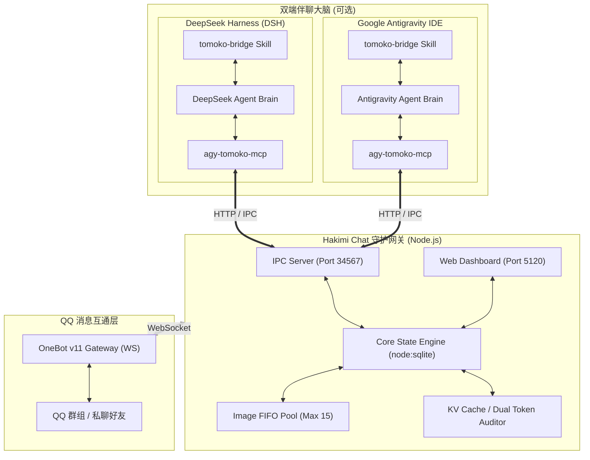

# 哈基米聊天系统 (Hakimi Chat) 🐾

<p align="center">
  
  
  
  
  
</p>

> **Hakimi Chat** is a high-performance, multi-persona AI companion brain bridging **Google Antigravity IDE** and **QQ (OneBot v11)**. It empowers LLMs with persistent spatial-temporal memory, multi-group reactive strategies, dynamic visual context management, KV Cache token monitoring, and a standalone cyberpunk-style Web dashboard.

---

## ✨ 核心特性

- 🟢 **微信 4.1 后台虚拟桌面无感伴聊**：原生支持 Windows 隔离桌面 (`WeChatBotDesktop`)，微信客户端在后台专属桌面独立运行，绝不抢占前台工作鼠标键盘焦点。提供 Port 34568 隔离网关与 Web 控制台热注册监听回路。
- 🧬 **Tulpa 五阶拟真交互与心理学伴聊架构**：
  - **半句话未完结等待**：智能正则感知碎句输入，本地自适应延长防抖等待 2.5s，彻底杜绝半路抢答浪费 Token。
  - **轻量社交行动决策**：支持输出 `[action:REPLY]` / `[action:SILENCE|理由]` / `[action:WAIT]`，群友闲聊智能静默观察，0 扰民 0 废话。
  - **仿生气泡打字延时与在途打断**：根据字数动态模拟人类手机打字速度；当用户在机器人排队发消息途中插话时，毫秒级打断并撤回剩余未发气泡。
  - **本地 SQLite FTS5 情境记忆检索**：分块全文检索历史会话与情境片段，动态激活长程记忆并最大化复用 KV Cache。
  - **0-Token 纯算法群聊黑话词频追踪**：采用纯数学统计与 N-gram 抽取群内高频网络用语与梗，零 API 消耗实现俚语自进化。
- 🧠 **双大脑架构 (Antigravity & DeepSeek Harness)**：不仅原生支持 Google Antigravity IDE 伴聊，还深度适配 DeepSeek Harness (DSH)。支持一键配置 (`npm run setup:dsh`)、长轮询原子消费与原生 MCP 发信。
- 🎭 **多人格动态切换系统**：
  - **智子 (Tomoko)**：傲娇高冷极客少女，熟悉代码梗与前沿技术。
  - **白龙娘 (Bailong)**：温婉威严的神明龙女，守护与治愈。
  - **小鲸鱼 (Whale)**：活力元气深海吉祥物，情绪价值拉满。
  - **Haena**：赛博朋克风独立执行者，利落干练。
  - 支持群级别独立绑定不同人格，好感度、时空状态双向持久化。
- 🎯 **拟真群聊与潜水拦截策略**：
  - **8s 批处理聚类**：防止短时间内多次触发造成刷屏与请求轰炸。
  - **潜水锁机制 (Dive Lock)**：自然参与讨论，话题结束自动退居幕后潜水。
  - **双平台黑白名单多群控制**：支持 QQ 真实群号与微信 `99xxxx` 虚拟频段群聊独立开关、触发率自适应调节。
- 🖼️ **严格 FIFO 视觉上下文防爆**：
  - 本地缓存严格限制 15 张图片先进先出（FIFO）淘汰机制，杜绝视觉输入导致 Context 窗口超限与费用失控。
- 📊 **双引擎 KV Cache 命中率与 Token 审计**：
  - 支持 Gemini、Claude 等主流模型与 **DeepSeek 官方原生 CNY 直结计费**（DeepSeek-V3 / R1 / 缓存命中节省 75%~90% / 节假日非高峰判定）。
  - 精确追踪物理 Prompt 缓存命中率与 API 成本明细，支持分客户端独立审计。
- 💻 **独立 Web 管理控制台 (Port 5120)**：
  - 基于 Vue 3 + Tailwind CSS + Chart.js 的开箱即用控制台。
  - 实时 SSE 状态流、QQ/微信双平台群聊图形化启闭与热注册、人格即时热切换、大脑引擎切换 (Antigravity / DSH)、聊天上下文查看与调试。
- ⚡ **原生轻量零沉重依赖**：
  - 依托 Node.js 原生 `node:sqlite` + WAL 模式，内置自动重试与定期 WAL Checkpoint 紧凑截断，无需编译外部数据库。

---

## 🏗️ 架构拓扑



---

## 📁 目录结构

```text
hakimi-chat/
├── .agents/
│   └── skills/
│       └── tomoko-bridge/      # Antigravity IDE 伴聊伴生 Skill
├── agents/                     # 标准化人设库与三层 Prompt 协议
│   ├── _base_protocol.md       # 底层通用约束协议 (去AI味、防破甲、群聊注意力)
│   ├── _affection_matrix.json  # 动态好感度态度映射矩阵
│   ├── tomoko.md               # 智子角色设定与 Few-shot 范例
│   ├── bailong.md              # 白龙娘角色设定
│   ├── whale.md                # 小鲸鱼角色设定
│   └── haena.md                # Haena 角色设定
├── config/
│   └── pricing.json            # 模型阶梯计费与 KV Cache 价格表
├── public/                     # Web 控制台前端静态资源 (Vue 3 + Chart.js)
│   ├── index.html              # 仪表盘入口
│   └── vendor/                 # 本地化离线依赖 (Tailwind, Vue, Chart.js)
├── scripts/                    # 辅助脚本
│   ├── send-qq.mjs             # 命令行直发 QQ 消息测试脚本
│   └── wait-for-qq-message.mjs # 消息轮询等待脚本
├── src/                        # 核心源码
│   ├── antigravity-discovery.mjs # Antigravity IDE 端口与实例自动发现
│   ├── bridge-daemon.mjs       # 守护进程主入口 (OneBot WS 客户端 + 调度)
│   ├── connect-rpc-client.mjs  # Antigravity RPC 客户端适配
│   ├── db.mjs                  # SQLite 存储层 (状态/好感度/聊天记录)
│   ├── mcp-server.mjs          # MCP 工具服务 (qq_send_message 等)
│   ├── personas.mjs            # 多人格三层 Prompt 装配引擎
│   ├── pricing.mjs             # Token 阶梯价格与 KV Cache 审计器
│   └── web-server.mjs          # 控制台 Web 服务器与 SSE 实时推流
├── test/                       # 单元测试与端到端模拟测试
├── config.example.json         # 配置文件模板
├── start.bat                   # Windows 一键自检与启动脚本
├── start.ps1                   # PowerShell 启动脚本
├── start.sh                    # Linux / macOS 一键启动脚本
├── package.json                # 项目依赖声明 (Node >= 22.5.0)
└── LICENSE                     # MIT 开源协议
```

---

## 🚀 快速上手

### 1. 环境准备
- **Node.js**：版本 `>= 22.5.0`（需支持原生 `node:sqlite`）。
- **OneBot v11 客户端**：如 [SnowLuma]([https://github.com/](https://github.com/SnowLuma/SnowLuma))。

### 2. 安装与配置
克隆仓库后安装轻量依赖：
```bash
git clone https://github.com/m-crowe/hakimi-chat.git
cd hakimi-chat
npm install
```

复制配置文件模板：
```bash
cp config.example.json config.json
```

编辑 `config.json` 填写你的 OneBot WebSocket 地址与认证信息：
```json
{
  "snowLuma": {
    "wsUrl": "ws://127.0.0.1:3000/",
    "token": "YOUR_ONEBOT_TOKEN_HERE",
    "botQqId": 123456789,
    "adminQqIds": [100000000],
    "allowedGroupIds": [100000000]
  },
  "antigravity": {
    "lsAddress": "http://127.0.0.1:6714",
    "agentPreset": "tomoko",
    "modelName": "gemini-2.5-pro",
    "maxTurns": 30
  },
  "web": {
    "port": 5120,
    "adminToken": "hakimi-admin-token-2026",
    "cors": true
  }
}
```

### 3. 一键启动
跨平台一键启动脚本：
```bash
# Windows PowerShell 自检脚本
./start.ps1

# Windows 双击或者 CMD
start.bat

# Linux / macOS
chmod +x start.sh && ./start.sh

# 通用 npm 脚本
npm start

# 启动微信 4.1 虚拟桌面后台伴聊服务 (Windows 独立桌面无感运行)
start-wechat-bot.bat

# 桌面切换辅助 (在前台主桌面与 WeChatBotDesktop 隔离桌面间切换查看)
switch-desktop.bat
```

### 4. 访问 Web 控制台
浏览器访问：`http://127.0.0.1:5120`，即可进入实时监控大屏：
- 查看各群聊的实时消息流与触发出队状态
- 一键切换当前群聊角色（智子 / 白龙娘 / 小鲸鱼 / Haena）
- 观察实时 Token 消耗、KV Cache 节省曲线与内存用量

---

## 🧩 大脑联动方式

### 方式 A：Google Antigravity IDE 联动
1. 将本项目的 `.agents/skills/tomoko-bridge` 引入你的工作区或全局 Agent Skills 目录。
2. 在 Antigravity 对话界面中输入：
   > `一键启动哈基米聊天系统`
3. Antigravity 将自动激活伴聊循环，通过内部 IPC 网关（`http://127.0.0.1:34567`）与 QQ 群消息形成实时闭环。

### 方式 B：DeepSeek Harness (DSH) 联动
1. 在项目根目录执行一键配置脚本（自动在 `~/.dsh` 注册 MCP 服务与伴聊 Skill）：
   ```bash
   npm run setup:dsh
   ```
2. 打开 DeepSeek Harness 桌面客户端，打开本项目目录 `D:\dsh\agy\hakimi-chat`。
3. 在 DSH 对话框中发送：
   > `一键启动哈基米聊天系统，人设使用 tomoko，进入伴聊响应循环`
   DSH 将自动执行长轮询脚本监听 QQ 消息，并通过原生 MCP 发信。
4. 详见完整文档：[docs/DSH_INTEGRATION.md](docs/DSH_INTEGRATION.md)。

---

## 🧪 自动化测试

运行内置全量测试套件（覆盖数据库、Web API、Token 计费、DSH 双端集成与模拟群聊拦截）：
```bash
# 全量测试
npm test

# 专门测试 DSH 计费与双端审计
npm run test-dsh
```
```

---

## 📜 开源协议

本项目采用 [MIT License](LICENSE) 授权开源。
Copyright (c) 2026 M-Crowe.
