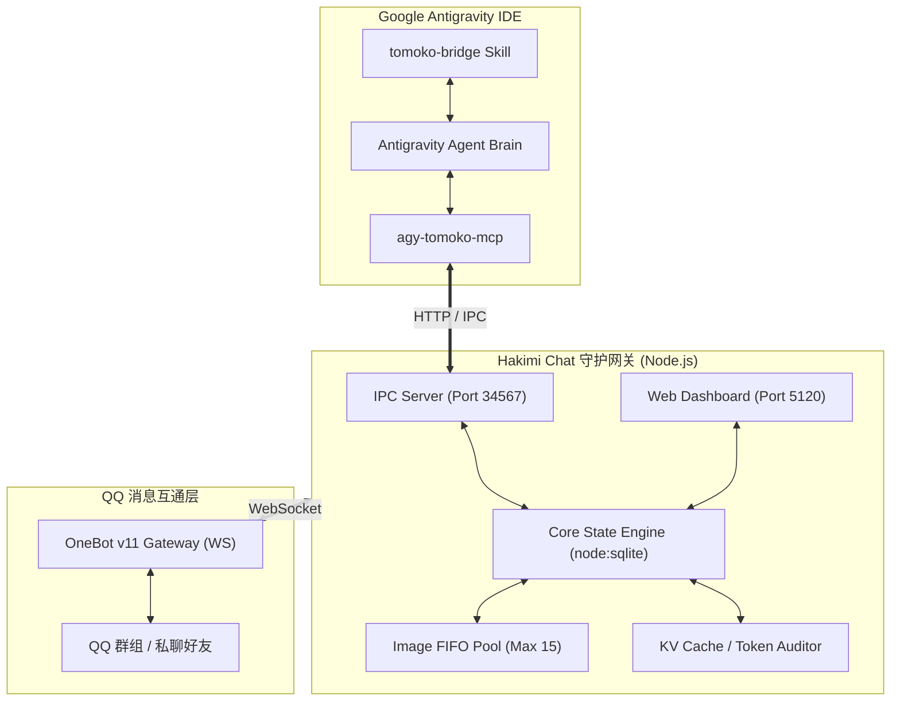

# 哈基米聊天系统 (Hakimi Chat) 🐾

<p align="center">
  
  
  
  
  
</p>

> **Hakimi Chat** is a high-performance, multi-persona AI companion brain bridging **Google Antigravity IDE** and **QQ (OneBot v11)**. It empowers LLMs with persistent spatial-temporal memory, multi-group reactive strategies, dynamic visual context management, KV Cache token monitoring, and a standalone cyberpunk-style Web dashboard.

---

## ✨ 核心特性

- 🧠 **Antigravity IDE 伴聊大脑架构**：将 Antigravity 的高智能编程/对话推理能力投射到 QQ 社交生态，实现 IDE 伴聊与多群互动的有机融合。
- 🎭 **多人格动态切换系统**：
  - **智子 (Tomoko)**：傲娇高冷极客少女，熟悉代码梗与前沿技术。
  - **白龙娘 (Bailong)**：温婉威严的神明龙女，守护与治愈。
  - **小鲸鱼 (Whale)**：活力元气深海吉祥物，情绪价值拉满。
  - **Haena**：赛博朋克风独立执行者，利落干练。
  - 支持群级别独立绑定不同人格，好感度、时空状态双向持久化。
- 🎯 **拟真群聊与潜水拦截策略**：
  - **8s 批处理聚类**：防止短时间内多次触发造成刷屏与请求轰炸。
  - **潜水锁机制 (Dive Lock)**：自然参与讨论，话题结束自动退居幕后潜水。
  - **黑白名单多群控制**：支持各群独立开关、触发率自适应调节。
- 🖼️ **严格 FIFO 视觉上下文防爆**：
  - 本地缓存严格限制 15 张图片先进先出（FIFO）淘汰机制，杜绝视觉输入导致 Context 窗口超限与费用失控。
- 📊 **KV Cache 缓存命中率与 Token 审计**：
  - 内置真实大模型 Token 阶梯计费（含 Gemini、Claude 等主流模型），精确追踪 Prompt 缓存命中率与 API 成本明细。
- 💻 **独立 Web 管理控制台 (Port 5120)**：
  - 基于 Vue 3 + Tailwind CSS + Chart.js 的开箱即用控制台。
  - 实时 SSE 状态流、群聊启闭、人格即时热切换、聊天上下文查看与调试。
- ⚡ **原生轻量零沉重依赖**：
  - 依托 Node.js 原生 `node:sqlite` + WAL 模式，无需安装编译 node-gyp 或外部数据库。

---

## 🏗️ 架构拓扑



---

## 📁 目录结构

```text
hakimi-chat/
├── .agents/
│   └── skills/
│       └── tomoko-bridge/      # Antigravity IDE 伴聊伴生 Skill
├── agents/
│   └── tomoko.md              # 智子角色设定与 Prompt 模板
├── public/                    # Web 控制台前端静态资源 (Vue 3 + Chart.js)
│   ├── index.html             # 仪表盘入口
│   └── vendor/                # 本地化离线依赖 (Tailwind, Vue, Chart.js)
├── scripts/                   # 辅助脚本
│   ├── send-qq.mjs            # 命令行直发 QQ 消息测试脚本
│   └── wait-for-qq-message.mjs # 消息轮询等待脚本
├── src/                       # 核心源码
│   ├── antigravity-discovery.mjs # Antigravity IDE 端口与实例自动发现
│   ├── bridge-daemon.mjs      # 守护进程主入口 (OneBot WS 客户端 + 调度)
│   ├── connect-rpc-client.mjs # Antigravity RPC 客户端适配
│   ├── db.mjs                 # SQLite 存储层 (状态/好感度/聊天记录)
│   ├── mcp-server.mjs         # MCP 工具服务 (qq_send_message 等)
│   ├── personas.mjs           # 多人格定义与提示词装载器
│   ├── pricing.mjs            # Token 阶梯价格与 KV Cache 审计器
│   └── web-server.mjs         # 控制台 Web 服务器与 SSE 实时推流
├── test/                      # 单元测试与端到端模拟测试
├── config.example.json        # 配置文件模板
├── start.bat                  # Windows 一键自检与启动脚本
├── start.ps1                  # PowerShell 启动脚本
├── package.json               # 项目依赖声明 (Node >= 22.5.0)
└── LICENSE                    # MIT 开源协议
```

---

## 🚀 快速上手

### 1. 环境准备
- **Node.js**：版本 `>= 22.5.0`（需支持原生 `node:sqlite`）。
- **OneBot v11 客户端**：如 [SnowLuma](https://github.com/)、[NapCatQQ](https://github.com/NapNeko/NapCatQQ) 或 [Lagrange](https://github.com/LagrangeDev/Lagrange.Core)。

### 2. 安装与配置
克隆仓库后安装轻量依赖：
```bash
git clone https://github.com/m-crowe/hakimi-chat.git
cd hakimi-chat
npm install
```

复制配置文件模板：
```bash
cp config.example.json config.json
```

编辑 `config.json` 填写你的 OneBot WebSocket 地址与认证信息：
```json
{
  "snowLuma": {
    "wsUrl": "ws://127.0.0.1:3000/",
    "token": "YOUR_ONEBOT_TOKEN_HERE",
    "botQqId": 123456789,
    "adminQqIds": [100000000],
    "allowedGroupIds": [100000000]
  },
  "antigravity": {
    "lsAddress": "http://127.0.0.1:6714",
    "agentPreset": "tomoko",
    "modelName": "gemini-2.5-pro",
    "maxTurns": 30
  },
  "web": {
    "port": 5120,
    "adminToken": "hakimi-admin-token-2026",
    "cors": true
  }
}
```

### 3. 一键启动
在 Windows 上可以直接双击运行 `start.bat`，或在命令行中运行：
```bash
# 方式一：PowerShell 自检脚本
./start.ps1

# 方式二：npm 脚本
npm start
```

### 4. 访问 Web 控制台
浏览器访问：`http://127.0.0.1:5120`，即可进入实时监控大屏：
- 查看各群聊的实时消息流与触发出队状态
- 一键切换当前群聊角色（智子 / 白龙娘 / 小鲸鱼 / Haena）
- 观察实时 Token 消耗、KV Cache 节省曲线与内存用量

---

## 🧩 Antigravity IDE 联动

1. 将本项目的 `.agents/skills/tomoko-bridge` 引入你的工作区或全局 Agent Skills 目录。
2. 在 Antigravity 对话界面中输入：
   > `一键启动哈基米聊天系统`
3. Antigravity 将自动激活伴聊循环，通过内部 IPC 网关（`http://127.0.0.1:34567`）与 QQ 群消息形成实时闭环。

---

## 🧪 自动化测试

运行内置全量测试套件（覆盖数据库、Web API、Token 计算与模拟群聊拦截）：
```bash
npm test
```

---

## 📜 开源协议

本项目采用 [MIT License](LICENSE) 授权开源。
Copyright (c) 2026 M-Crowe.
