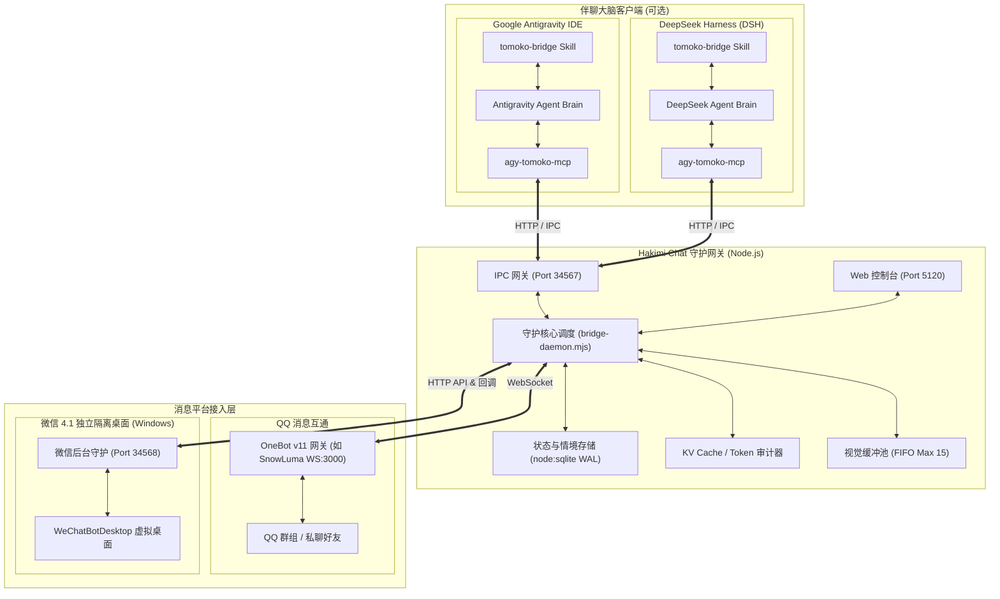

# 哈基米聊天系统 (Hakimi Chat) 🐾

<p align="center">
  
  
  
  
</p>

> **Hakimi Chat** 是一个面向 AI 智能体（Google Antigravity IDE、DeepSeek Harness 等）的高性能本地伴聊网关与大脑桥接系统。
> 系统将大语言模型与 **QQ (OneBot v11)** 及 **微信桌面端（Windows 后台隔离桌面）** 无缝连接，提供拟真社交动力学、长程情境记忆、多群独立人设管理、严格视觉防爆池、KV Cache 与 Token 成本审计，以及轻量独立的 Web 管理控制台。

---

## 🏗️ 架构拓扑



---

## ✨ 核心特性

### 1. 多平台原生接入
- **QQ 机器人 (OneBot v11)**：基于标准 WebSocket 连接（推荐搭配 [SnowLuma](https://github.com/SnowLuma/SnowLuma)），支持群聊与私聊消息收发、CQ 码解析与长消息合并转发。
- **微信桌面端 (Windows 4.1 专属)**：独占 Windows 后台虚拟桌面 (`WeChatBotDesktop`) 静默收发，不抢占前台键盘鼠标焦点；微信群映射为 `99xxxx` 虚拟频段，支持 Web 控制台热注册监听与启闭。

### 2. 双伴聊大脑无缝协同
- **Google Antigravity IDE**：通过专属伴生 Skill (`tomoko-bridge`) 与本地 IPC 网关（Port 34567）构建端到端响应闭环。
- **DeepSeek Harness (DSH)**：原生支持 DSH 客户端，支持一键注册 MCP 工具 (`npm run setup:dsh`) 与长轮询原子消费机制。

### 3. 拟真社交交互动力学
- **半句话未完结等待**：智能识别输入中的碎句与未说完标点，本地自动延长防抖等待（默认 2.5s），彻底杜绝半路抢答浪费 Token。
- **轻量社交行动决策**：模型可自主输出 `[action:REPLY]` / `[action:SILENCE|理由]` / `[action:WAIT]`，闲聊时智能潜水围观，0 废话 0 扰民。
- **仿生打字延时与在途打断**：根据回复字数动态模拟人类手机打字速度；当用户在中途插话时，毫秒级打断并撤回剩余未发气泡。
- **群聊俚语与黑话追踪**：纯本地词频统计与 N-gram 分析，零 API 消耗自适应群内流行梗。

### 4. 多人格与长程情境记忆
- **内置 4 款预设人设**（支持群级别独立绑定）：
  - **智子 (`tomoko`)**：傲娇高冷极客少女，喜爱单机游戏、麦茶与技术梗。
  - **白龙娘 (`bailong` / `dragon_girl`)**：温婉威严的神明龙女，守护与治愈系日常。
  - **小鲸鱼 (`whale` / `little_whale`)**：活力元气深海吉祥物，情绪价值拉满。
  - **Haena (`haena`)**：街头辣妹风格，利落干练的赛博朋克独立执行者。
- **状态与好感度持久化**：群聊独立人设绑定，好感度增减（`[af:±x|原因]`）与时空身位（`[state:地点|动作|细节|心境]`）双向持久化。
- **SQLite FTS5 长程记忆检索**：分块检索历史会话与情境片段，动态激活长程记忆并最大化复用 KV Cache。

### 5. 成本精细管控与视觉防爆
- **严格 FIFO 视觉防爆池**：本地缓存限制 15 张图片先进先出（FIFO）淘汰，杜绝视觉输入导致上下文暴涨与费用失控。
- **KV Cache 命中率与 Token 审计**：支持 Gemini/Claude 与 DeepSeek 官方人民币计费（含 V3/R1、缓存命中 75%~90% 折算与非高峰优惠），支持分客户端独立审计。

### 6. 独立 Web 管理控制台 (Port 5120)
- 基于 Vue 3 + Tailwind CSS + Chart.js 的开箱即用控制台。
- 提供实时 SSE 状态流、群聊图形化启闭与热注册、人设热切换、双端引擎切换与 Token 审计。

---

## 🚀 快速上手

### 1. 环境准备
- **Node.js**：版本 `>= 22.5.0`（需支持原生 `node:sqlite`）。
- **OneBot v11 服务端**：如 [SnowLuma](https://github.com/SnowLuma/SnowLuma)。
- *(可选)* **Python 3.10+**：仅在使用微信后台虚拟桌面伴聊时需要（需安装 `pywin32` 和 `pillow`）。

### 2. 安装与配置

克隆仓库并安装依赖：
```bash
git clone https://github.com/m-crowe/hakimi-chat.git
cd hakimi-chat
npm install
```

复制配置文件模板：
```bash
cp config.example.json config.json
```

编辑 `config.json`，核心配置示例与说明：

```json
{
  "snowLuma": {
    "wsUrl": "ws://127.0.0.1:3000/",
    "token": "",
    "botQqId": 123456789,
    "adminQqIds": [100000000],
    "allowedGroupIds": [100000000]
  },
  "antigravity": {
    "lsAddress": "http://127.0.0.1:6714",
    "agentPreset": "tomoko"
  },
  "dsh": {
    "enabled": true,
    "defaultModel": "deepseek-flash"
  },
  "daemon": {
    "internalHttpPort": 34567
  },
  "chatBehavior": {
    "debounceMs": 2500,
    "maxImages": 15
  },
  "web": {
    "port": 5120,
    "adminToken": "hakimi-admin-token-2026"
  }
}
```

| 模块 | 字段 | 类型 | 默认值 | 说明 |
| :--- | :--- | :--- | :--- | :--- |
| `snowLuma` | `wsUrl` | String | `ws://127.0.0.1:3000/` | OneBot v11 服务端 WebSocket 地址 |
| `snowLuma` | `token` | String | `""` | OneBot 连接鉴权 Token（若服务端开启鉴权） |
| `snowLuma` | `botQqId` | Number | - | 机器人自身的 QQ 号 |
| `snowLuma` | `adminQqIds` | Array | `[100000000]` | 管理员 QQ 号列表（具备群管与调试特权） |
| `snowLuma` | `allowedGroupIds` | Array | `[100000000]` | 允许响应的真实 QQ 群号白名单 |
| `antigravity` | `lsAddress` | String | `http://127.0.0.1:6714` | Antigravity 语言服务端口 |
| `antigravity` | `agentPreset` | String | `"tomoko"` | 默认人格 (`tomoko`/`bailong`/`whale`/`haena`) |
| `dsh` | `enabled` | Boolean | `true` | 是否启用 DeepSeek Harness 支持 |
| `daemon` | `internalHttpPort` | Number | `34567` | 内部 IPC 通信端口 (MCP 与微信网关回调) |
| `chatBehavior` | `debounceMs` | Number | `2500` | 半句话未完结防抖延时 (ms) |
| `chatBehavior` | `maxImages` | Number | `15` | 单会话 FIFO 视觉图片最大缓冲数量 |
| `web` | `port` | Number | `5120` | Web 管理控制台端口 |
| `web` | `adminToken` | String | `"hakimi-admin-token-2026"` | Web 控制台管理员鉴权密钥 |

### 3. 启动运行

项目提供**跨平台统一进程守护总管（Process Supervisor）**，支持双击交互式菜单与 CLI 命令行快速拉起，具备端口自动释放、子进程异常自愈与熔断、优雅退出和日志大小轮转：

```bash
# 通用启动（在终端弹出交互式菜单或直接全量启动）
npm start

# Windows（双击 start.bat 即可弹出控制台交互菜单）
.\start.bat

# Linux / macOS
chmod +x start.sh && ./start.sh
```

**命令行快捷参数（跳过菜单直接启动）**：
```bash
npm run start:all       # 全量伴聊模式 (Node.js QQ + Python 微信4.1)
npm run start:qq        # 仅启动 QQ 核心服务 (Port 34567, 5120)
npm run start:wechat    # 仅启动微信后台守护服务 (Port 34568)
npm run switch:desktop  # 调起微信后台虚拟桌面穿梭器 (Windows)
```

> **提示**：若使用微信 4.1 伴聊，首次使用需初始化 Python 虚拟环境与依赖：
> ```bash
> python -m venv .venv-wechat
> .venv-wechat\Scripts\pip install pywin32 pillow wechatauto
> ```

### 4. 访问 Web 控制台
浏览器访问：`http://127.0.0.1:5120`
- 实时监控消息出入队与触发出流
- 图形化开启/关闭群聊、切换群聊绑定的角色人设
- 观察实时 Token 消耗走势与 KV Cache 节省曲线

---

## 🧩 大脑联动配置

### 方式 A：Google Antigravity IDE 联动
1. 将本项目 `.agents/skills/tomoko-bridge` 引入你的工作区或全局 Agent Skills 目录；
2. 在 Antigravity 对话框中输入：
   > `一键启动哈基米聊天系统`
3. Antigravity 将自动激活伴聊循环，通过内部 IPC 网关（`http://127.0.0.1:34567`）与消息队列形成实时响应闭环。

### 方式 B：DeepSeek Harness (DSH) 联动
1. 在项目根目录执行一键配置脚本（自动在 `~/.dsh` 中注册 MCP 服务与伴生 Skill）：
   ```bash
   npm run setup:dsh
   ```
2. 打开 DeepSeek Harness 客户端，打开本项目目录。
3. 在 DSH 对话框中输入：
   > `一键启动哈基米聊天系统，人设使用 tomoko，进入伴聊响应循环`
4. 详见进阶说明文档：[docs/DSH_INTEGRATION.md](docs/DSH_INTEGRATION.md)。

---

## 📁 核心目录结构

```text
hakimi-chat/
├── .agents/skills/tomoko-bridge/ # Antigravity IDE 伴聊伴生 Skill
├── agents/                       # 标准人设与 Prompt 协议 (tomoko, bailong, whale, haena)
├── config/                       # 模型价目表与计费配置 (pricing.json)
├── docs/                         # 进阶集成文档 (DSH_INTEGRATION.md)
├── public/                       # Web 控制台前端静态资源 (Vue 3 + Tailwind CSS + Chart.js)
├── scripts/                      # 微信隔离桌面守护、DSH 安装及辅助脚本
├── src/                          # 核心源码
│   ├── bridge-daemon.mjs         # 网关守护主程序 (OneBot WS 客户端 + 消息分发调度)
│   ├── db.mjs                    # SQLite 存储层 (状态/好感度/FTS5 情境记忆)
│   ├── mcp-server.mjs            # MCP 工具服务 (qq_send_message 等)
│   ├── personas.mjs              # 多人格 Prompt 装配引擎
│   ├── pricing.mjs               # Token 阶梯价格与 KV Cache 审计器
│   ├── web-server.mjs            # 控制台 Web 服务器与 SSE 推流
│   ├── antigravity-discovery.mjs # Antigravity 实例与端口探针
│   └── dsh-discovery.mjs         # DeepSeek Harness 会话与用量探针
├── scripts/
│   ├── launcher.mjs              # 跨平台统一进程守护总管 (生命周期/熔断自愈/日志大小轮转)
│   ├── wechat-service.py         # 微信 4.1 独立隔离桌面后台服务 (不抢焦点)
│   └── legacy/                   # 旧版启动脚本安全归档目录
├── test/                         # 单元测试与端到端自动化测试套件
├── config.example.json           # 配置文件模板
├── start.bat                     # Windows 极简一键自检与启动脚本 (直调 launcher.mjs)
├── start.sh                      # Linux/macOS 跨平台启动脚本
├── start.ps1                     # PowerShell 快捷脚本
└── package.json                  # 项目依赖与快捷脚本
```

---

## 🧪 自动化测试

项目基于 Node.js 原生 Test Runner 编写了完整的测试套件：

```bash
# 运行全量测试 (覆盖数据库、Web API、Token 计费、交互决策与微信管理等)
npm test

# 运行特定模块测试
npm run test-db       # SQLite 存储层测试
npm run test-tulpa    # 拟真交互动力学与在途打断测试
npm run test-dsh      # DSH 计费与双端审计测试
npm run test-wechat   # 微信群管理与虚拟频段分配测试
npm run test-token    # Token 阶梯计费与缓存测试
npm run test-config   # Web 控制台配置接口测试
```

---

## 📜 开源协议

本项目采用 [MIT License](LICENSE) 授权开源。
